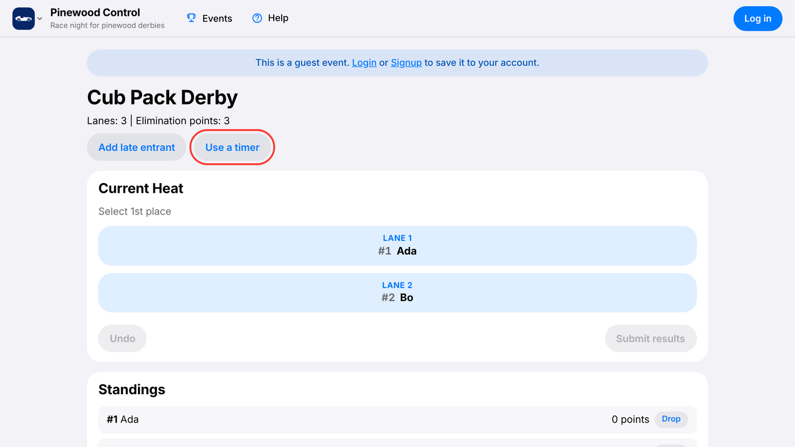
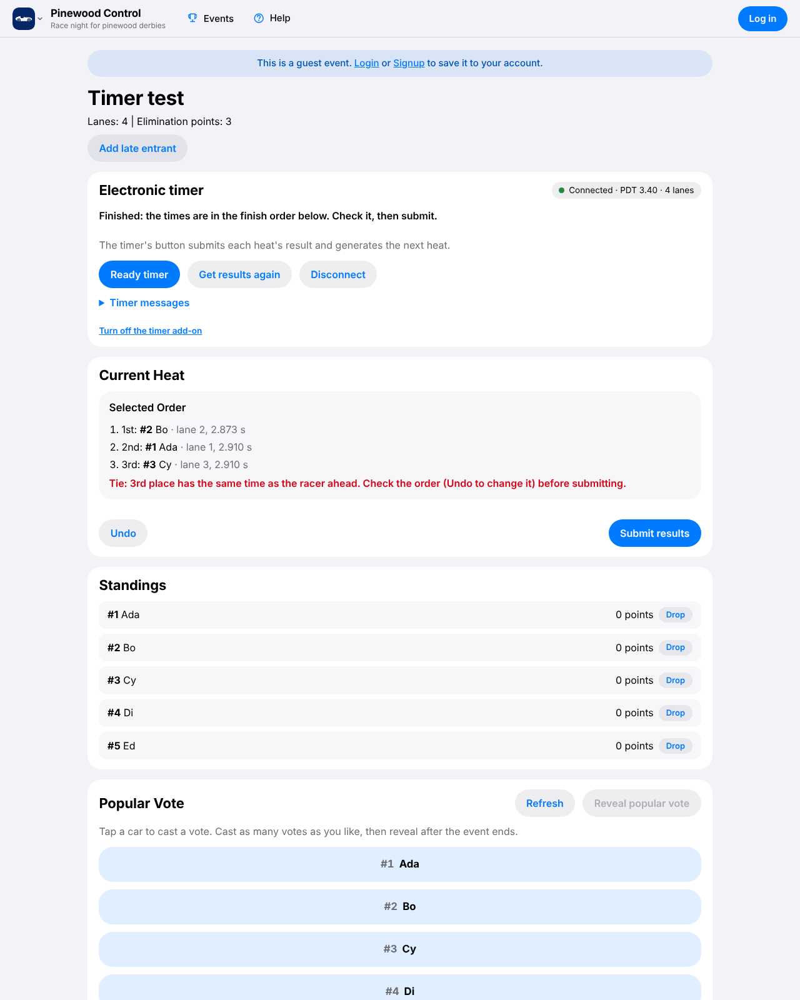
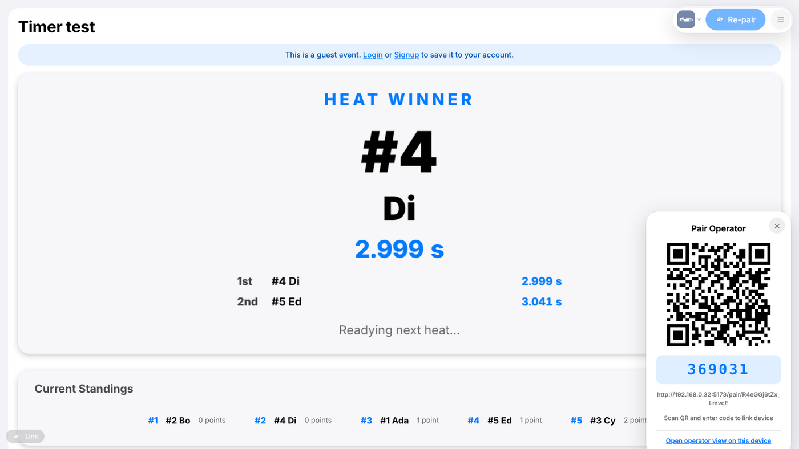

# Pinewood Control

Pinewood Control is a web app for running a Pinewood Derby style race with a **Kiosk display** and an **Operator/Controller** device. It uses **ladderless elimination** (1st=0 points, 2nd=1 point, etc.) and supports:

- Live updating results via Socket.IO
- Mid-event late entrants (with a points penalty) and racer drop-outs (recorded in history)
- Anonymous “Popular Vote” with a controller-triggered reveal + kiosk countdown
- Signed-in accounts with reusable **Race Patrols** (racer groups) for faster event setup: type them in, upload a CSV (adding to or replacing the patrol), or import them from **Scouts Australia's Terrain** and resync later
- Saved **Race Setups** (lanes, elimination points, theme, weight unit), so an event is set up in one tap and only needs its racers
- An optional **electronic timer** add-on: a PDT-compatible timer (such as [pinewood-time](https://github.com/no5tyle/pinewood-time)) plugged into the operator's computer fills in each heat's finish order from its lane times, and the kiosk shows the times. See [Electronic timer](#electronic-timer-optional)

Live app: https://pinewood.qstored.org. Free, always. Accounts are [qStored](https://qstored.org) accounts, the same as the Program Builder's.

## Look

Pinewood Control shares one look with qStored's other apps: Apple's system colours and font, rounded cards, capsule buttons, a see-through bar across the top, and dark mode that follows the device. The colours, rounding and font are in `frontend/src/base.css` (a copy of no5tyle's shared stylesheet), before `src/index.css`. The qStored app switcher at the top left is `frontend/public/qstored-switcher.js`, the same file as in qStored's other apps.

- **Computer:** the bar shows the app's name, Events, Patrols, Setups and Help, with your account at the right (Sign out is in its menu).
- **Phone:** the bar shows the name and one menu button holding everything.
- **Kiosk:** the bar shrinks to a small glass capsule in the corner, and the kiosk keeps its own big-screen themes (System, Cubs Australia, BSA).

## How it’s used

- **Kiosk device** (big screen): open the Kiosk page for the event and display standings/results.
- **Operator device** (phone/tablet/laptop): pair to the kiosk using QR + code, then run heats and submit full finish order each race.
- **Guests** can run events locally (guest mode). Signed-in accounts support multi-device access and Race Patrols.
- **Electronic timer** (optional): plug a PDT-compatible timer into the operator's computer and the finish order fills itself in. See [below](#electronic-timer-optional).

## Electronic timer (optional)

Off unless you turn it on, and only offered on a computer. On **Race Control**, in Chrome or Edge on a computer, press **Use a timer**, next to Add late entrant. It's remembered on that device. Phones and tablets don't show the button: a timer can't be plugged into them, and Safari and Firefox can't use serial ports.



1. Plug a PDT-compatible timer into the computer by USB and press **Connect timer**. The browser asks you to choose its port the first time; after that it reconnects by itself.
2. Each new heat readies the timer, with the empty lanes left out so the race doesn't wait for them.
3. When the cars are in, the finish order fills itself in, fastest first, with each car's lane and time. Two cars on the same time, or a lane with no time (placed last), are flagged: check them, using Undo to change the order, then submit.
4. With a [pinewood-time](https://github.com/no5tyle/pinewood-time) timer, its button submits the heat and generates the next one, so a race can run from the track. While connected, the app points the button at itself, and stops it also typing a key; that isn't saved on the timer.



The times are saved with each heat. The kiosk shows them on the heat winner screen, and as "Last heat" under the next heat. Heats entered by hand look as they always have.



**Turn off the timer add-on**, at the bottom of the timer card, puts Race Control back as it was.

How it works: the browser talks to the timer over the [Web Serial API](https://developer.mozilla.org/docs/Web/API/Web_Serial_API) (`frontend/src/shared/pdtSerial.ts`). The protocol and the finish-order logic are pure and tested (`frontend/src/shared/pdt.ts`), the connection is `frontend/src/hooks/useTimer.ts`, and the card is `frontend/src/components/TimerPanel.tsx`. The backend only stores each heat's times (its `laneTimes`); nothing on the server talks to the timer.

## Tech stack

**Frontend** (`frontend/`, on Firebase Hosting at pinewood.qstored.org)
- React 19 + TypeScript, React Router 7, Vite 8
- Socket.IO client
- QR tools: `qrcode`, `html5-qrcode`
- Web Serial (Chrome and Edge) for the optional electronic timer
- Sign-in with qStored accounts (email link, or Microsoft), through Firebase Authentication's REST API: `src/shared/account.ts`

**Backend** (`backend/`, on Cloud Run as `pinewood-api`)
- Node.js 22, Express 5, Socket.IO, Zod
- Firestore for data, Firebase Authentication ID tokens for sign-in (`firebase-admin`)
- Tests with Vitest, in memory and on the Firestore and Authentication emulators

## How the data is kept

Everything is in the qStored Google Cloud project's Firestore database, in collections starting `pinewood`:

- **`pinewoodEvents`**: one document per event, holding its racers, heats and history, so a result or a new heat is one atomic change and a live screen gets the whole event in one read.
- **`pinewoodVotes`**, **`pinewoodPatrols`** (with their racers), **`pinewoodSetups`**.
- **`pinewoodKioskSessions`** (by token), **`pinewoodPairings`** (by QR token), **`pinewoodGuestLinks`**.

Short-lived records and unclaimed guest events carry an `expireAt` time, and Firestore's TTL policy deletes them (guest events after 24 hours, kiosk sessions after 3 hours, pairing codes after 2 minutes, guest kiosk links after 7 days). Firestore can take up to a day to do so, so the API checks the times itself too. The TTL policies and index settings are in [programmer-api's `firestore.indexes.json`](https://github.com/no5tyle/programmer-api/blob/main/firestore.indexes.json), which owns the database's configuration.

`backend/src/server/store/db.ts` is the small interface the routes use, with a Firestore version and an in-memory one for tests. An event's owner is its qStored account's Firebase uid.

## Local development

Needs Node.js 22 and Java 21 (for the Firebase emulators).

```bash
cd backend
npm install
npm test                 # the API's tests, in memory
npm run test:emulators   # the same tests, also against the Firestore and Authentication emulators
npm run dev              # the API on :8787, against the emulators (data is lost when it stops)
```

```bash
cd frontend
npm install
VITE_FIREBASE_API_KEY=fake VITE_AUTH_EMULATOR_HOST=127.0.0.1:9099 npm run dev
```

The dev server sends `/api` and `/socket.io` to the API on :8787. Sign-in links from the Auth emulator aren't emailed: they're listed at `http://127.0.0.1:9099/emulator/v1/projects/demo-qstored/oobCodes`. Sign in with Microsoft can't be tried on the emulator. The app's settings are in `frontend/.env.example`.

## Deployment

On every push and pull request, GitHub Actions (`.github/workflows/deploy.yml`) tests the API (with the emulators) and the app. On `main` it then builds the API's container and deploys it to Cloud Run, and builds the app and deploys it to Firebase Hosting. Google is signed in to without stored keys (Workload Identity Federation).

### One-time setup

In the qStored production project (`PROJECT` below), in `australia-southeast1`:

1. **The API's account.** Make a service account for it with **Cloud Datastore User** (Firestore) and nothing else:

   ```bash
   gcloud iam service-accounts create pinewood-api --project PROJECT
   gcloud projects add-iam-policy-binding PROJECT \
     --member serviceAccount:pinewood-api@PROJECT.iam.gserviceaccount.com --role roles/datastore.user
   ```

2. **The Cloud Run service**, made once with its settings; later deploys only change the image. It scales to zero when no one's racing, and to at most one instance, so every screen of an event is on the same server for the live updates. Session affinity keeps Socket.IO's connection on it, and the long timeout lets a kiosk stay connected through a race night:

   ```bash
   gcloud run deploy pinewood-api --project PROJECT --region australia-southeast1 \
     --image us-docker.pkg.dev/cloudrun/container/hello \
     --service-account pinewood-api@PROJECT.iam.gserviceaccount.com \
     --min-instances 0 --max-instances 1 --session-affinity --timeout 3600 \
     --cpu 1 --memory 512Mi --allow-unauthenticated \
     --set-env-vars CORS_ORIGIN=https://pinewood.qstored.org
   ```

   Its address (`https://pinewood-api-….run.app`) is `API_ORIGIN` below. To use `https://pinewood-api.qstored.org` instead, map that domain to the service (Cloud Run → Manage custom domains) and add the DNS record it shows.

3. **The Hosting site.** Firebase console → Hosting → Add another site, named `qstored-pinewood`. Then add the custom domain `pinewood.qstored.org` to it and add the DNS records it shows.

4. **Sign-in.** Firebase console → Authentication → Settings → Authorised domains: add `pinewood.qstored.org`. If Sign in with Microsoft is on, nothing else is needed: it uses the same Firebase sign-in, which comes back to `pinewood.qstored.org/login`.

5. **Expiry.** Deploy the Firestore settings from programmer-api (`firebase deploy --only firestore --project PROJECT`), which turns on the `expireAt` TTL policies.

6. **Deploys from GitHub.** Use the deploy service account the other qStored repos use (`github-deploy@PROJECT.iam.gserviceaccount.com`), with a Workload Identity provider for `no5tyle/pinewood-control` the same way as theirs. It needs **Artifact Registry Writer**, **Cloud Run Admin**, **Firebase Hosting Admin**, and **Service Account User** on `pinewood-api@PROJECT.iam.gserviceaccount.com`:

   ```bash
   gcloud iam service-accounts add-iam-policy-binding pinewood-api@PROJECT.iam.gserviceaccount.com \
     --project PROJECT --member serviceAccount:DEPLOY_SA --role roles/iam.serviceAccountUser
   ```

7. **The repository's variables** (Settings → Secrets and variables → Actions → Variables):

   | Variable | Value |
   | --- | --- |
   | `PROJECT` | the project id |
   | `WIF_PROVIDER` | the Workload Identity provider's full name |
   | `DEPLOY_SA` | the deploy service account's email |
   | `API_ORIGIN` | the API's address, from step 2 |
   | `FIREBASE_API_KEY` | the project's web API key (the same as the other qStored sites') |
   | `MICROSOFT_SIGN_IN` | `true` to offer Sign in with Microsoft |

   The deploys are skipped until `PROJECT` is set. Push to `main` (or re-run the workflow) to deploy.

8. **The old address.** Once pinewood.qstored.org works, switch off the old server and database, and point pinewood.nostyle.app at the new address (a redirect at its DNS or host) or remove it. Accounts and events on the old server aren't carried over: leaders sign in with a qStored account and set up their Race Patrols again.

### What it costs

With no one racing, nothing runs: Cloud Run scales to zero and Firestore charges only for what's stored. A race night is one small instance for a few hours, and a few thousand Firestore reads and writes, well within the free tiers.

## Licence

Copyright (c) 2026 no5tyle. Source available under the [PolyForm Strict License 1.0.0](LICENSE.md): you may use it for noncommercial purposes, but not change it, share copies or use it commercially. All other rights reserved.

## Keeping its page on qstored.org up to date

A major change (a feature added, changed or removed, a new plan limit, a redesigned screen) also updates
Pinewood Control's page on qstored.org (/pinewood-control), in the same piece of work:

1. Update its features on qstored.org's product page (/pinewood-control): in no5tyle/qstored, change `scripts/product-pages.py` (each feature's heading, plan badges with any limit, and a few words) and run `python3 scripts/product-pages.py`.
2. If a screen it shows has changed, retake the pictures: `node scripts/product-shots.cjs ../qstored/shots/pinewood-control` from this repository (see the script's first lines for what must be running), then `python3 scripts/product-images.py` in no5tyle/qstored.
3. Demo data in screenshots uses short, clean names and emails (Akela, `akela@example.com`): never real people, and never long generated addresses.
